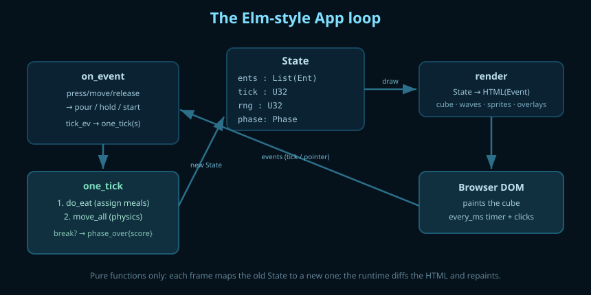
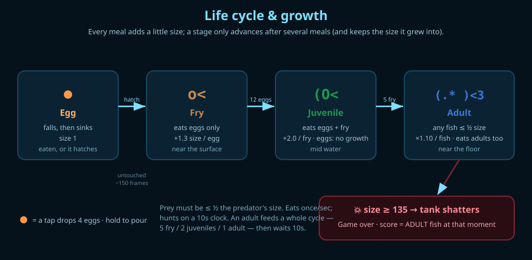
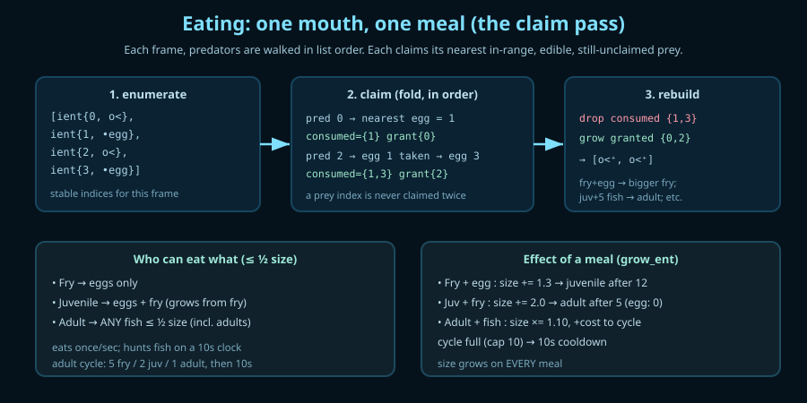
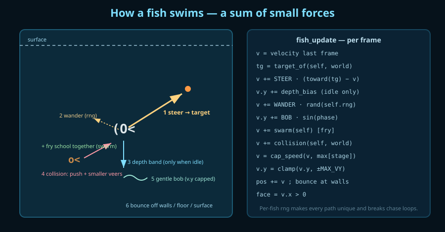
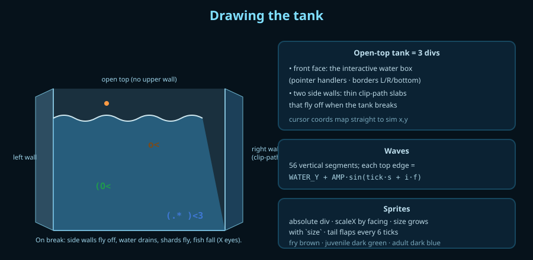

# Aquarium — how it works

A tiny self-contained aquatic ecosystem written in **Bend 2** (2.0.40) as an
`App`: the same pure program opens a native window and runs in a browser page.
Drop food into a glass cube of water and watch a food chain bootstrap itself:
eggs hatch into fry, fry grow into juveniles, juveniles into adults, and
adults hunt each other until one grows too big and shatters the tank.

It is a companion piece to `growing_tree`, but where the tree is a
**discrete cellular grid**, the aquarium lives in **continuous space**: every
creature is a record with floating-point position and velocity, nudged each
tick by a handful of simple steering forces.

- Source: [`main.bend`](./main.bend) · tests: [`test.bend`](./test.bend) ·
  web page source: [`web/index.html`](./web/index.html) · build: [`build.sh`](./build.sh)
- Built web app: [`aquarium.html`](./aquarium.html) (single file, no server needed)

---

## 1. Running it

Native (X11 window of 620 × 380; Linux needs `libx11-dev`, and a desktop
session — without a display `Window.open` fails with exit code 95):

```sh
cd Bend2/aquarium
bend main.bend --check-only          # ALL PROOFS CHECK
bend main.bend -o /tmp/aquarium && /tmp/aquarium
```

Browser: open [`aquarium.html`](./aquarium.html). It is rebuilt from
`web/index.html`, which imports `main.bend` directly:

```sh
bend web/index.html -o /tmp/aquarium_web        # bundle the page + compiled Bend
bun web/inline.mjs /tmp/aquarium_web aquarium.html   # inline it into one file
```

`sh build.sh` does all of it: check, headless tests, native build, web page.

**Click — or hold — above the waterline** to pour eggs and start (eggs only
drop from above the surface). Hold the button down to pour a continuous
stream. Your goal is to grow one adult big enough to shatter the glass; your
**score is the number of adult fish** alive at that moment (with the surviving
fry and juveniles noted too). After the break, click to play again. **R**
restarts at any time; **Esc** (or closing the window) quits the native app.
The native build also prints the game-over line on stdout.

---

## 2. Architecture — the `App` loop



*(The diagram shows the old HTML loop; the shape is the same, but the view
is now an `Image` and time comes from a clock instead of a DOM timer.)*

```
main() = App.run(~Aq, ~App{Aq.view, Aq.io_tick}, "Aquarium", 620, 380, Aq.init())
```

- **`Aq`** (the state) holds everything: the world (`+List<Ent>`), a tick
  counter `tick`, a global `rng` seed, a `phase` (`Start` / `Play` /
  `Over{score, at}`), the hold-to-pour cursor, the `clock` of the last tick
  and a `told` flag (game-over line printed).
- **`Aq.view : Aq → Aq & Image`** (pure) draws the cube, waves, every
  creature and any overlay as an `Image` quadtree (see §9).
- **`Aq.step(now_ms, events, s) : Maybe<Aq>`** (pure) folds the frame's
  `Event`s — `Press` down (start / pour / begin holding), `Move` (follow the
  cursor), `Press` up / `Leave` (stop pouring), `Key` R (restart), Esc or
  `Close` (`None`: quit) — then runs every 45 ms tick that is due at `now`
  (`FRAME_MS`, ≈ 22 ticks/second whatever the display rate; at most
  `MAX_CATCHUP = 3` per frame). One tick is `sim_tick = pour_step ∘ one_tick`,
  exactly the old `tick_ev` handler: advance the simulation and, while the
  button is held, trickle `POUR_N` eggs in at the cursor.
- **`Aq.io_tick`** is the only IO: it reads `IO.now()`, calls `Aq.step`, and
  prints the game-over line once.

The browser page calls the very same `Aq.view` / `Aq.step` (compiled to JS)
from `requestAnimationFrame`, turns DOM pointer/key events into Bend `Event`
values, paints the quadtree into a canvas, and shows `Aq.hud_text` /
`Aq.status_text` above it.

---

## 3. The world: `Ent` and `Stage`

Eggs and fish share **one** record type so the world is a single flat list we
can fold over uniformly:

```
type Stage is Data:
  Egg{}
  Fry{}
  Juv{}
  Adult{}

type Ent is Data:
  Ent{stage: Stage,
    x: F32, y: F32,      # center position, in pixels of the front face
    vx: F32, vy: F32,    # velocity, px/tick
    size: F32,           # scale: drives sprite size AND the prey size-cap
    timer: U32,          # eggs: ticks sinking (hatch countdown)
                         # fish: ticks since its last meal (the 1-second eat cooldown)
    hu: U32,             # fish: ticks since its last FISH meal (the 10-second hunt clock)
    fed: U32,            # fry: eggs eaten; juveniles: fry eaten; adults: cycle units
    rng: U32,            # per-creature seed, so each one wanders differently
    face: Bool}          # True = facing right (sprite mirrored)
```

Because the model is continuous, there is no grid: there are just `Ent`s
floating in a `560 × 380` box, and accessors (`Ent.x`, `Ent.y`, `Ent.size`,
`Ent.stage`, `Ent.timer`, …) keep the hot loops readable. Every type is
`Data`, so the world list is shared freely (`+List<Ent>`) by the O(n²)
passes.

---

## 4. The life cycle



| Stage | Sprite | Eats | Grows | Becomes |
|------|--------|------|-------|---------|
| **Egg** | orange dot | — | — | a **fry** if left untouched ~150 ticks |
| **Fry** | small brown fish | eggs only | +1.3 size per egg | a **juvenile** after **12** eggs |
| **Juvenile** | dark-green fish | **eggs + fry** (grows only from fry) | +2.0 per fry (eggs: 0) | an **adult** after eating **5** fry |
| **Adult** | big dark-blue fish with a dorsal fin | **any fish ≤ ½ its size** (incl. other adults) | ×1.10 size per fish | shatters the tank at size ≥ 135 |

**Who eats whom.** A predator can eat prey only if the prey is **at most half
its size** (`PREY_RATIO = 0.5`) *and* the prey is in its tier (`tier_ok`):
fry eat eggs; **juveniles eat eggs *and* fry — but only fry grow them** (an egg
is just consumed); and **adults eat any fish — fry, juveniles, even other
adults — that is ≤ ½ their size**. Only adults are unrestricted by stage.

**Two clocks pace feeding:**

- Every fish may only **eat once per second** (`EAT_COOLDOWN` on `timer`).
- A juvenile or adult only sets off to **hunt fish on a ~10-second clock**
  (`HUNT_PERIOD` on the separate `hu` clock); between hunts they just cruise.

**The adult feeding cycle.** Once an adult starts feeding it keeps eating (one
bite/second) until it has consumed a full **cycle** — **5 fry, or 2
juveniles, or 1 other adult** (prey are worth `FRY_COST 2 / JUV_COST 5 /
ADULT_COST 10` units, cap `CYCLE_CAP 10`). Only when the cycle fills does its
`hu` clock reset, so it then **waits ~10 s before the next cycle**. (Fry have
no hunt clock — they graze eggs every second; juveniles reset `hu` per fry, so
they take one fry per ~10 s and need 5 to mature.)

**A fish grows a little with *every* meal** — each bite bumps `size`, and the
sprite size is a continuous function of `size`, so a creature visibly swells as
it feeds; a stage only *advances* after its meal count, keeping the grown size.

This makes the chain self-balancing *and* keeps the food web flowing: clicking
makes eggs; uneaten eggs become fry; fry mature into juveniles; juveniles
crop fry; adults crop juveniles and fry. To push one adult to the breaking
size you have to keep the whole pyramid below it fed.

---

## 5. One simulation step (`one_tick`)

When `phase = Play`, each tick runs:

```
one_tick:
  1. do_eat(ents)   → assign meals, remove eaten, grow eaters, detect a break
  2. if something broke → Over{score, tick}
     else move_all(ents)   → run physics on every creature
```

(`after_eat` does step 2.) In `Over`, `fall_all` replaces the swim update; in
`Start` nothing moves. Eating happens **before** movement, on the same
snapshot, so all the "who's next to whom" decisions use one consistent
picture of the world.

---

## 6. Eating: one mouth, one meal



Naively, "every fish eats whatever it overlaps" lets two fish both eat the same
egg, or one egg feed a whole crowd. Instead `do_eat` runs a small **assignment
pass** so each piece of prey feeds at most one predator:

1. **`enumerate`** tags every entity with a stable index for this tick.
2. **`claim`** folds over the predators *in list order*. A predator is skipped
   unless it is a fish **off its eat cooldown** (`can_act`: `timer ≥
   EAT_COOLDOWN`). Otherwise it calls `find_prey`, which scans for the
   **nearest** prey that is in biting range, `edible`, and **not already
   claimed**, then records a `consumed` index and a `grant` carrying the prey's
   **stage**. `edible` = `can_eat` (right tier **and** prey ≤ ½ predator size)
   **and**, if the prey is a *fish*, the predator must be in its hunt window
   (`hu ≥ HUNT_PERIOD`); eggs may be eaten any time (so fry and juveniles graze
   eggs subject only to the 1-second cooldown).
3. **`rebuild`** produces the next world: drop everything in `consumed`, and
   apply `grow_ent(e, prey_stage)` to everyone who got a grant.

`grow_ent` always resets the 1-second `timer`, but **size and maturation depend
on what was eaten**: a fry grows from eggs; a **juvenile grows only from fry**
(an egg it eats is just consumed — no size, no progress); an adult grows from any
fish. The **hunt clock `hu`** resets per fry-meal for a juvenile, but for an
**adult only when its feeding cycle fills**: the adult adds the prey's
`stage_cost` to `fed` and, once that reaches `CYCLE_CAP`, zeroes `fed` and `hu`
(starting the ~10 s cooldown); otherwise it keeps `hu` high and feeds again.
`any_broken` then checks `BREAK_SIZE`.

---

## 7. Movement — a sum of small forces



`fish_update` rebuilds a fish's velocity each tick by adding up cheap forces,
clamping to a per-stage max speed, integrating, and bouncing off the walls:

1. **Steer toward the target** (`steer`) — turn velocity a fraction `STEER`
   toward the chosen food/prey at the stage's cruise speed.
2. **Wander** — a small random push derived from the fish's own `rng`. This is
   what keeps a chase from locking into an infinite loop and gives each fish its
   own personality.
3. **Depth band** (`depth_bias`) — a gentle pull toward the stage's preferred
   depth (fry high, juveniles mid, adults low), applied **only when the fish
   has no target** so a fish chasing food still dives/rises freely.
4. **Swarming** (`swarm`, fry only) — within `SWARM_R2` a fry steers toward
   the **centroid** of nearby fry (cohesion) and matches their average
   **heading** (alignment), so fry drift around together as a loose school.
5. **Collision** (`coll_vec`) — fish may overlap a little, but past
   `COLLIDE_FRAC` of their combined radii they repel, weighted by mass so the
   bigger one shoves the smaller; the **smaller fish also veers sideways** to
   pick another path. Predator/prey pairs are **skipped** — that overlap is a
   meal, not a bump (so a hunter swims straight into its prey to eat it).
6. **Bob** — a slow, gentle sine term (vertical motion is also clamped to
   `MAX_VY`, so fish rise and sink calmly rather than darting up and down).
7. **Walls** (`wx`/`wy`) — clamp to the box and flip the relevant velocity
   component. `face` is then set from the sign of `vx`.

### Targeting rules (`target_of`)

- **Fry** → always the nearest **egg** (plus the swarm pull).
- **Juvenile** → grazes the nearest **egg**; in its hunt window it instead
  chases the nearest edible **fry** (eating eggs feeds it nothing, but it still
  clears them).
- **Adult** → in its hunt window it hunts the nearest edible fish (any stage
  ≤ ½ its size, including other adults); otherwise it cruises, drifting toward
  the floor.

`nearest` does a single linear scan; the per-tick cost is `O(n²)` (targeting +
swarm + collision per fish, plus the claim pass).

**No entity cap.** `spawn_eggs_at` — the only way entities are added (tap and
held pour both go through it) — now spawns whenever the source is above the
waterline, with **no upper limit** on the population. Hatching and eating never
raise the count, but pouring does, so a long hold can grow the world without
bound. That keeps the tank as full as you like, at the cost of the `O(n²)`
per-tick work growing with the population — so a very crowded tank can slow
down. (Re-introducing a cap is a one-line guard in `spawn_eggs_at` if needed.)

---

## 8. Physics of falling and sinking (`egg_update`)

An egg behaves differently above and below the surface (and eggs only ever
*enter* above the waterline — `spawn_eggs_at` refuses to drop them in the water):

- **In air** (`y < WATER_Y`): accelerate downward under `AIR_GRAV` up to
  `AIR_MAXFALL`, with a tiny sideways drift — a quick, straight-ish fall.
- **In water**: ease toward a slow terminal `SINK_SPEED`, add a `sin` wobble so
  it drifts as it sinks, and rest on the floor. Meanwhile `timer` counts up; at
  `HATCH_TICKS` the egg **hatches** into a fry in place (size `FRY_BORN` ≈ 3,
  a random facing and a fresh velocity). If a fish eats it first, it never
  hatches.

---

## 9. Rendering the tank



*(The diagram shows the old DOM layering; the layers are the same.)*

The frame is a pure `Image` quadtree (`Pix{color}` / `Qua{tl, tr, bl, br}`)
over the 620 × 380 window, built in two steps:

1. **`Aq.scene`** lists the frame's shapes bottom to top — `Box`, `Oval`
   and `Tri` (each with a 0xRRGGBB color). Each layer prepends its shapes onto
   the layers above it: side walls (`L.walls`), the glass face (`L.face`),
   water bands + waves (`L.water`), sand and glass borders (`L.glass`),
   creatures (`L.ents`), shards (`L.shards`), the HUD (`L.hud`), overlays
   (`L.overlay`).
2. **`render`/`draw`** walks the quadtree from a 1024 root, like the shader
   guide's tile tree: each node keeps only the shapes whose box meets it
   (`cut_go`) and learns whether the topmost of them covers it (`Cut.st`). An
   empty node is one background `Pix`, a covered node one `Pix` of that color,
   only mixed nodes split, and a 1-px node takes the color of the last shape
   containing its center (`pix_col`). The four children are a parallel let.
   About 30 000 leaves per frame; ≈5 ms per tick+frame natively with ~70
   creatures, ≈25-30 ms per frame in the JS build.

- **The tank** is open-topped: a 560-px **front face** (glass borders left,
  right and bottom only), between two **side walls** drawn as slanted
  quadrilaterals (two `Tri`s each). Translucency is baked into opaque colors.
  Pointer coordinates map onto sim `(x, y)` as `x − DZ` (`DZ = 30`).
- **Waves** are `N_WAVE = 56` thin segments. Each segment's top edge sits at
  `WATER_Y + drop + WAVE_AMP·sin(tick·WAVE_SPEED + i·WAVE_FREQ)`, plus a bright
  3-px crest; below the lowest trough the water is six horizontal bands, light
  to deep. `drop` is `0` while playing and grows during the break (the water
  visibly **drains** away).
- **Sprites** are pixel art from the same `size` as the physics: an egg is a
  3-px orange disc; a fish is an oval body (half-width `r·body_w`, adults the
  widest), a triangular tail on the side opposite its heading (mirrored by
  `face`), a dorsal fin on adults, and an eye. The tail flaps between two
  frames every `FRAME_TICKS` ticks. Fry are brown, juveniles dark green,
  adults dark blue.
- **Text** uses a built-in 3×5 pixel font (`Font.runs`, one `Box` per run of
  lit pixels): the HUD line (adults / juveniles / fry) at the top, the start
  panel, and the game-over panel. The web page additionally shows the HUD and
  status as DOM text.
- **The tank break** (`Over`) is driven by `over_t = tick − at`: the two
  **side walls fly off** (translate + rotate around their centers, fading into
  the background), the water **drains**, 12 glass **shards** tumble outward
  under gravity, and every fish gets **X eyes** and **falls to the floor**
  (`fall_ent` instead of the swim update). After `OVER_PANEL_DELAY` ticks the
  game-over panel shows the adult score and the surviving fry/juveniles.

---

## 10. Randomness, time, and not getting stuck

- **RNG** is a single linear-congruential step, `rng_next`. The global seed
  drives spawns; every creature also carries its **own** seed so the wander
  force differs per fish. `rand_unit` maps a seed to a float in `[-1, 1)`.
- **Time** is the tick counter `tick`; durations are in ticks (`HATCH_TICKS`,
  `EAT_COOLDOWN`, `HUNT_PERIOD`, …). Ticks are paced by a millisecond clock
  passed to `Aq.step` (`IO.now()` natively, `performance.now()` in the page),
  so the simulation runs at the same speed on any display.
- **Anti-stuck**: the per-fish wander, the collision push (the smaller fish
  veers off to pick another path), and re-choosing targets every tick
  together prevent fish from orbiting a target forever or freezing against a
  wall.
- **Termination**: every loop is structural (over lists or a `Nat` count),
  so the whole program checks with no `@unsafe`.

---

## 11. Constants to tune

All near the top of `main.bend` (each is a zero-argument `def`):

| Constant | Meaning |
|----------|---------|
| `WF`, `HF`, `DZ` | front-face size and side-wall thickness (window 620 × 380) |
| `WATER_Y`, `FLOOR` | surface line and sandy floor |
| `FRAME_MS`, `MAX_CATCHUP` | tick interval (≈ speed of everything); ticks caught up per frame |
| `HATCH_TICKS` | hatch delay |
| `EAT_COOLDOWN`, `HUNT_PERIOD` | 1-second eat cooldown; 10-second fish-hunt gate |
| `AIR_GRAV`, `AIR_MAXFALL`, `SINK_SPEED` | fall / sink feel |
| `PREY_RATIO` | prey must be ≤ this × predator size (0.5 = half) |
| `FRY_BORN`, `FRY_GROW`, `FRY_MEALS` | fry birth size, per-egg growth, eggs to mature |
| `JUV_GROW`, `JUV_MEALS` | juvenile growth per fry, fry to mature |
| `ADULT_MUL`, `BREAK_SIZE` | adult growth per fish; size that shatters the tank |
| `FRY_COST`, `JUV_COST`, `ADULT_COST`, `CYCLE_CAP` | adult feeding-cycle: prey unit costs + cycle size |
| `STEER`, `DEPTH_K`, `WANDER`, `BOB_AMP/F`, `MAX_VY`, `MARGIN`, `SURF_PAD`, `EAT_PAD` | swim feel (`MAX_VY` caps up/down speed) |
| `COLLIDE_FRAC`, `COLL_STR`, `VEER` | collision: overlap limit, push, smaller-fish veer |
| `SWARM_R2`, `COHESION`, `ALIGN` | fry schooling radius² and pull strengths |
| `SPAWN_N`, `POUR_N` | eggs per tap; eggs per held tick (no entity cap) |
| `FRAME_TICKS` | tail-flap period |
| `N_WAVE`, `SEG_W`, `WAVE_AMP/SPEED/FREQ` | surface look |
| `OVER_GRAV`, `DRAIN_SPEED`, `SHARD_SPEED`, `OVER_PANEL_DELAY` | break animation |
| `COL_EGG`, `COL_BROWN`, `COL_GREEN`, `COL_DBLUE`, `water_col`, `face_col`, … | colors (0xRRGGBB) |

---

## 12. How the behaviour was verified

`test.bend` imports `main.bend` and drives its *pure* transition functions
directly (`do_eat`, `one_tick`, `run_ticks`, `Aq.press`, …) — no window
needed. Build and run it natively:

```sh
bend test.bend -o /tmp/aquarium_test && /tmp/aquarium_test
```

It prints one line per check — **34/34 passing** on Bend 2.0.40:

```
T1  egg -> fry hatch (born size)          T18 adult ignores egg
T2  egg falls in air                      T19 juvenile eats fry (hunt clock resets)
T3  egg sinks (stays egg)                 T20 tier + half-size sanity
T4  fry -> juvenile after 12 eggs         T21 score counts adults only
T5  juvenile -> adult after 5 fry         T22 eat cooldown (1/sec)
T6  adult grows -> break                  T23 game-over fish fall
T7  fry eats egg                          T24 pour only above water
T8  shared egg -> 1 eater                 T25 hunt gate (fish / 10s)
T9  break -> game over phase              T26 hunt clock reset rules
T10 eggs hatch over time                  T27 fry swarm cohesion
T11 busy world stable (1620 ticks)        T28 fish collision push
T12 fry forages (1 egg / second)          T29 no entity cap (50 taps -> 200 eggs)
T13 no-food wander stable (2000 ticks)    T30 no entity cap (pour 300 ticks)
T14 juvenile grows from fry               T31 juvenile eats egg, no growth
T15 adult grows gradually (x1.10)         T32 adult eats adult
T16 more meals per stage                  T33 adult cycle: 5 fry
T17 adult eats juvenile                   T34 adult cycle: 2 juveniles
```

T11 and T13 also assert that no position is NaN or outside the box. T30 holds
the button for 300 ticks: ~600 eggs go in and the world keeps several hundred
creatures (hatched fry eat part of the stream), far beyond any cap.

The JS build agrees with the native one: the same scripted pour (60 ticks,
then 10 / 200 / 1500 more) gives identical counts and identical position
sums (to F32 print precision) from the native binary and from
`bend main.bend -o aquarium.mjs` run under `bun`. The web page was smoke-run
headlessly (fake DOM, 300 frames with a click above the water): it paints
every frame and shows the HUD/status from `Aq.hud_text` / `Aq.status_text`.
