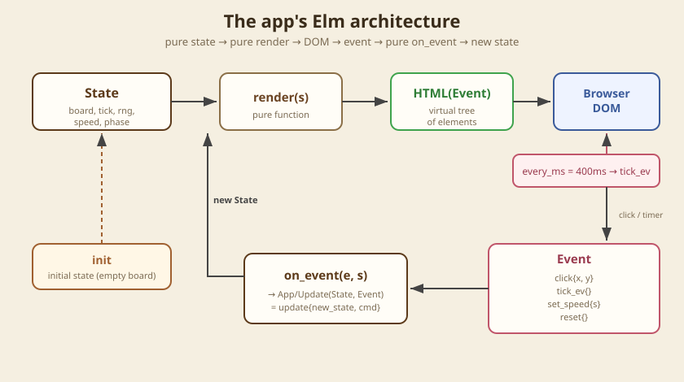
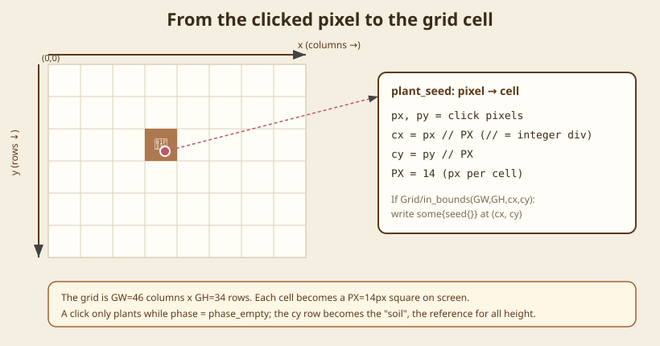
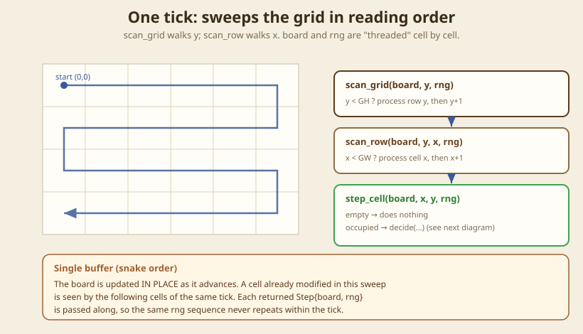
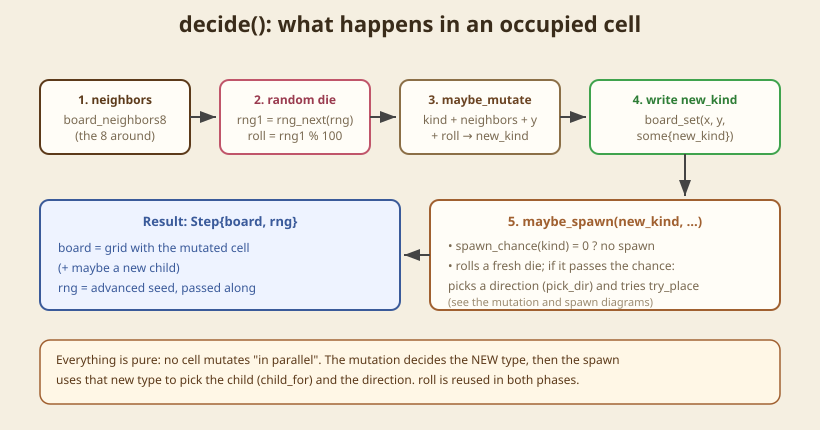
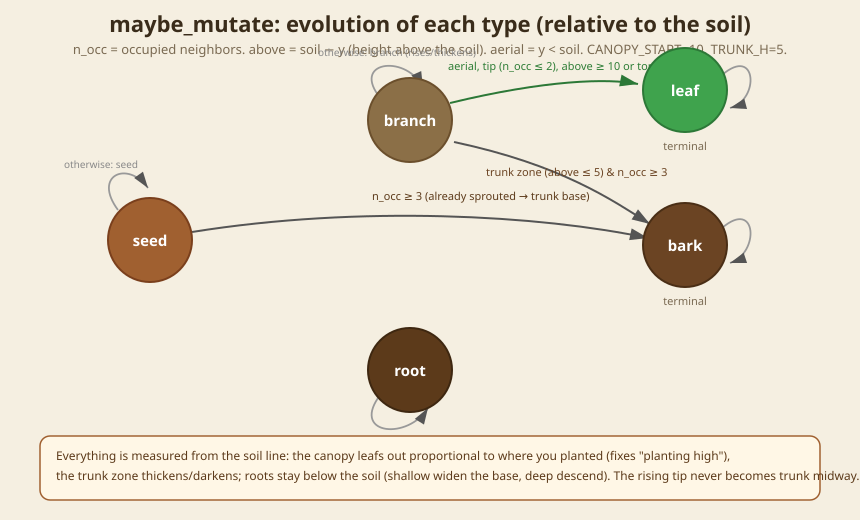
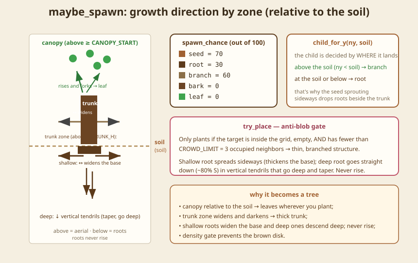
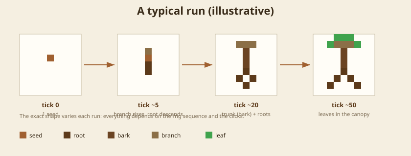

# Growing Tree — exactly how the program works

An illustrated guide to the `main.bend` in this folder: a cellular automaton
that grows a "tree" from a seed planted with a click. Each section points to
the exact function(s) in the code.

> Ported to **Bend 2.0.40** (the `App` model: a pure state, an `Image`
> quadtree per frame, Base `Event`s). Sections name functions, not line
> numbers.

## Table of contents

1. [30-second overview](#1-30-second-overview)
2. [The architecture: the Elm loop](#2-the-architecture-the-elm-loop)
3. [The types: what the world knows](#3-the-types-what-the-world-knows)
4. [Planting: from pixel to cell](#4-planting-from-pixel-to-cell)
5. [One tick: sweeping the grid](#5-one-tick-sweeping-the-grid)
6. [A cell's decision](#6-a-cells-decision)
7. [Mutation: the state machine](#7-mutation-the-state-machine)
8. [Spawning: growing in space](#8-spawning-growing-in-space)
9. [The side-effect-free RNG](#9-the-side-effect-free-rng)
10. [Render: from grid to pixels](#10-render-from-grid-to-pixels)
11. [Speed and the timer](#11-speed-and-the-timer)
12. [Timeline of a run](#12-timeline-of-a-run)
13. [How to run](#13-how-to-run)

---

## 1. 30-second overview

You click on an empty frame → a **seed** is born, and the click point
becomes the **soil line** (marked by a dashed line). On each *tick*, the
program sweeps the entire grid; every occupied cell can (a) **mutate** into
another type and (b) **spawn** a child into an empty neighbor. Over time the
pattern looks like a tree: roots descending below the soil, a thick trunk
rising, branches and leaves in the canopy. Since everything is measured
relative to the soil line, the tree stays proportional wherever you plant it.

There are five cell types (`type GT`): `seed`, `root`, `bark`, `branch`,
`leaf`. Everything is a pure function — there is no hidden mutable state; the
entire world lives in a single `State` value.

---

## 2. The architecture: the App loop



(The diagram shows the old HTML-emitting version; the loop is the same idea.)

`main` is one line: `App.run(~State, ~App{Tree.view, Tree.tick}, "Growing
Tree", WIN_W(), WIN_H(), init())`. Base's `App.run` opens a window and, once
per displayed frame (~60 Hz):

- **`Tree.view(s)`** returns the state beside an **`Image`** — a quadtree of
  `Pix{color}` / `Qua{tl, tr, bl, br}` — which the window shows.
- **`Tree.tick(events, s)`** receives that frame's Base `Event`s (`Press`,
  `Key`, `Close`, ...) and answers `Some{next}` or `None` (quit). It is just
  `IO.pure` around the pure **`Tree.step`**: fold the events (`events`), then
  advance the clock one frame (`frame`).
- **`init()`** is the empty board: `tick=0`, `rng=12345`, speed `Normal`,
  phase `Unplanted`.

Everything except `main` and `Tree.tick` is pure, so the browser page
(`web/index.html`) imports `main.bend` and calls the very same `Tree.step` /
`Tree.view`, and `test.bend` drives them headlessly.

---

## 3. The types: what the world knows

```python
type GT is Data:      Seed{} Root{} Bark{} Branch{} Leaf{}     # cell kinds
type Speed is Data:   Stopped{} Normal{} Fast{} Unlimited{}
type Phase is Data:   Unplanted{} Growing{}
type Board is Data:   BLeaf{v: U32}  BNode{tl, tr, bl, br}     # 64x64 quadtree
type State is Data:
  State{board: Board, tick: U32, rng: U32, speed: Speed, phase: Phase,
        soil: U32, tx: U32, wait: U32}
```

- A cell is a `U32` code on the board: `0` empty, then `gt_code`
  (1 seed, 2 root, 3 bark, 4 branch, 5 leaf).
- **`board`** is a Data **quadtree** over 64 x 64 cells, of which the
  **46 x 34** grid is used. A `BLeaf` stands for a whole uniform square (the
  empty board is one `BLeaf{0}`); `bget`/`bset` walk 6 levels. Being `Data`,
  the sweep reads it freely, and the view walks it in the same shape as the
  `Image` it paints. Reads outside the grid answer empty (`cell_get`).
- **`soil`** / **`tx`**: the planted row (soil line) and column (trunk axis);
  every height rule is relative to `soil`.
- **`wait`** counts display frames toward the next timer fire (§11).

---

## 4. Planting: from pixel to cell



A left-button `Press{.., x, y, .., 0, True{}}` (window pixels, `F32`) goes to
`click`, which converts with `px_cell`: `cx = x / PX`, `cy = y / PX`
(`PX = 16`, was 14: a power of two makes a cell exactly one quadtree node).

`plant_cell` only acts in phase `Unplanted` and inside the grid: it writes a
seed at `(cx, cy)`, switches to `Growing`, and stores **`soil = cy`** and
**`tx = cx`**. `plant_base` stamps the base at once: a **2-cell** shoot above
(`branch` at `cy-1`, `cy-2`) and **one root on each side** at the soil row. A
second click is ignored. The view then draws the **dashed soil line** on the
top edge of row `soil`.

---

## 5. One tick: sweeping the grid



A *tick* (`one_tick`) walks the **entire** grid in reading order, using
nested recursion counted down by `Nat` fuel (so termination is checked):

- `scan_grid(34n, y, ..)` — for each row `y` from 0 to `GH-1`.
- `scan_row(46n, x, y, ..)` — for each column `x` from 0 to `GW-1`.
- `step_cell` — empty cell: does nothing; occupied: calls `decide`.

**Crucial detail — single buffer:** the `board` is updated *in place* and the
resulting `(board, rng)` pair is passed to the next cell. That is, a cell
already touched in this tick is seen by the following cells of the **same**
tick (snake order), and the `rng` advances continuously, never repeating the
same sequence within the sweep.

**Trunk push (secondary growth).** Beyond the sweep, every
`TRUNK_PUSH_PERIOD` ticks `one_tick` calls `maybe_push`: in the central band
of columns (`tx ± TRUNK_HALF`), `shift_col_up` shifts the entire aerial part
of that column **one row up** and inserts a compact block of `bark` at the
base. The effect: **trunk chunks** appear that push the tree above them
upward — the trunk thickens and rises over time, making the center denser,
like the secondary growth of a real tree. The growing tip (at the top)
remains a branch and keeps sprouting the canopy while the base accumulates
trunk.

`band_top_clear` is the brake: the push only happens while **row 0** (the top
edge) of the trunk band is empty. When the tree is pushed to the edge of the
screen, the push stops — so the trunk **doesn't grow infinitely** nor throw
cells off the frame.

---

## 6. A cell's decision



`decide(kind, board, x, y, rng, soil, tx)` is the per-cell pipeline (the
`soil` is threaded through the whole sweep for the height rules):

1. **Neighbors** — `count8` counts the occupied 8 surrounding cells.
2. **Die** — `rng1 = rng_next(rng)`, `roll = rng1 % 100` (0–99).
3. **Mutation** — `mutate(kind, n_occ, y, soil, roll)` decides the **new type**.
4. **Write** — `cell_set(board, x, y, gt_code(new_kind))`.
5. **Spawn** — `maybe_spawn(new_kind, board, x, y, rng1, soil)` may write a
   child into an empty neighbor.

Returns `(board, rng)`. Note that the same `roll` is used in both the
mutation **and** spawn phases.

---

## 7. Mutation: the state machine



`mutate` is the aesthetic heart. It uses `n_occ` = occupied neighbors
(`count8`) and, **relative to the soil line**, `above = soil - y`
(how far above the soil the cell is) and `aerial = y < soil`. The height
constants are `CANOPY_START = 10` (from how high the tips leaf out) and
`TRUNK_H = 5` (the trunk zone near the soil).

| From     | To       | Condition                                                      |
| -------- | -------- | -------------------------------------------------------------- |
| `seed`   | `bark`   | `n_occ ≥ 3` (already sprouted → trunk base)                    |
| `seed`   | `seed`   | otherwise (still sprouting)                                    |
| `branch` | `leaf`   | aerial, tip (`n_occ ≤ 2`), and `above ≥ 10` **or** at the top (`y ≤ 1`) |
| `branch` | `bark`   | trunk zone (`above ≤ 5`) and `n_occ ≥ 3` (thickens/darkens)    |
| `branch` | `branch` | otherwise (keeps growing/rising)                               |
| `root`   | `root`   | always — roots never surface nor become aerial                |
| `bark`   | `bark`   | terminal                                                       |
| `leaf`   | `leaf`   | terminal                                                       |

The logic in words:

- **Relative height** is what fixes "planting high". Before, the canopy was a
  fixed band of `y`; planting high made the seed already be born "in the
  canopy", so it sprouted little and only sent roots. Now the canopy
  (`above ≥ 10`) and the "at the top of the screen" rule (`y ≤ 1`) guarantee
  a canopy proportional to *where* you planted — no more "just two leaves".
- The **trunk zone** (aerial and `above ≤ 5`) hardens into `bark` when
  well-connected (`n_occ ≥ 3`), and in that band the branches also spread
  sideways (see §8) — that's what makes the **trunk thick and dark**. The
  rising tip is above that band (and has `n_occ ~2`), so it **never** becomes
  trunk midway; it keeps rising.
- **Roots** only grow below the soil and **never** rise nor surface — they
  always stay `root` (thin and dark). Near the base they spread sideways,
  thickening the base; deeper down they descend as tendrils.

Measured with `test.bend` (planting at column 23, 60 ticks, rng 12345):
planting **above the middle** (soil=14) → 46 branches, 19 leaves, 44 trunk,
122 roots; planting high (soil=8) → 6 branches, 8 leaves, 22 trunk, 182
roots; soil=14 after 400 ticks → 66 branches, 30 leaves, 53 trunk, 137
roots. (The figures this guide used to quote, ~72/28/24/23, came from an
older revision of the constants: an independent JavaScript transliteration of
the pre-port `main.bend`, with 32-bit wrapping arithmetic, gives exactly the
numbers above, so the port is faithful to the code as it was.)

---

## 8. Spawning: growing in space



`maybe_spawn`:

1. `spawn_chance(kind)`: `seed`=70, `root`=34, `branch`=60, `bark`=0,
   `leaf`=0 (out of 100). The chances are deliberately high — what holds back
   the growth is the **density gate** (step 5). Chance 0 → no spawn.
2. Rolls a fresh die; if `roll ≥ chance`, no spawn this tick.
3. `pick_dir(kind, rng, x, y, soil, tx)` — direction in **8 options** (N, NE,
   E, SE, S, SW, W, NW), biased by type **and** position:
   - **branch in the trunk zone** (`above ≤ 5`): spreads sideways too
     (N + E/W + NE/NW) → **thickens the trunk**;
   - **branch in the canopy**: rises and forks (~40% N, NE/NW);
   - **shallow root** (`depth ≤ 2`) **within `ROOT_HALF` columns of the
     trunk (`tx`)**: flares sideways (E/W + SE/SW) → **thickens the base**.
     Beyond `ROOT_HALF`, it **stops widening** and only descends (S) — the
     base never expands horizontally forever;
   - **deep root**: ~80% **straight down** (S) → vertical tendrils that go
     deep and taper;
   - roots **never grow upward**;
   - **seed**: sprouts sideways (E/W → base roots) and a bit N/S (the trunk
     itself was already planted by `plant_base`).
4. `step_dir` computes the neighbor coordinate (including diagonals; clamped
   at 0 by `sat_sub`).
5. `try_place` — the anti-blob piece: it only writes if the cell is **inside
   the grid**, **empty**, **and** has fewer than `CROWD_LIMIT = 3` occupied
   neighbors. Keeps the structure thin and branched (instead of a disk).
6. `child_for_y(ny, soil)` decides the child **by the position where it
   lands**: above the soil line (`ny < soil`) → `branch` (aerial part); at the
   soil level or below → `root`. That's why the seed sprouting sideways (E/W,
   at the soil level) drops **roots** beside the trunk, connecting root and
   bark. Roots never rise, so they stay contained below the soil.

---

## 9. The side-effect-free RNG

There is no "real" randomness (that would be a side effect). The state carries
`rng: U32` and uses a linear congruential generator:

```bend
def rng_next(+s: U32) -> U32:
  (s * 1103515245 + 12345 : U32)   # wraps mod 2^32
```

Each `rng_next` produces the next deterministic number. Since the sweep
threads the `rng` cell by cell and tick by tick, the sequence never repeats
within a sweep — but the **same initial seed** always produces the same tree
(useful for reproducing and testing). `init` and `reset` use `rng=12345`.

---

## 10. Render: from grid to pixels

`Tree.view` hands the state back beside `render(s)`, an `Image` quadtree. The
window is `46*16 = 736` x `35*16 = 560` px: the 34 board rows plus one HUD row.
The image's root is the power of two over it (1024 px = 64 cells), anchored
at the top-left, exactly how Base's window (and the web page) paints it.

- `draw(d, flat, board, x0, y0, ..)` recurses over cells in the board's own
  quadtree shape. `region` decides, per square, whether it is one `Pix`:
  off the board and HUD (black, outside the window), or one uniform `BLeaf`
  wholly on the board with no soil line through it (its `color_of`). Only
  mixed squares split, so an empty board is a handful of nodes.
- A single cell is `Pix{color_of(v)}`; on the soil row, `soil_px` splits the
  16-px cell to draw the **2-px dashed soil line** (`#b08d57`) on its top
  edge (only once planted).
- The **HUD row** (`hud_cell`): five swatches on the left are the color
  legend (seed, root, trunk, branch, leaf); four on the right are the speeds
  (play, fast, max, pause), the current one lit. Native windows have no text,
  so this is the whole legend there; the web page also shows a text legend,
  the toolbar and the status line (`Tree.status`: tick, speed and a census).

Colors: board `#f5efe1`, `seed #a06030`, `root #5c3a1a`, `bark #6b4423`,
`branch #8b6f47`, `leaf #3fa34d`.

---

## 11. Speed and the timer

The old page fired a `tick_ev` timer every `tick_ms`; an `App` is called
once per displayed frame (~60 Hz), so `frame` counts frames in `wait` and
fires every `fire_frames(speed)` frames, running `steps_per_fire(speed)`
ticks (`run_ticks`, each including the trunk push):

| Speed       | key            | frames per fire (old ms) | ticks per fire |
| ----------- | -------------- | ------------------------ | -------------- |
| `Stopped`   | `p` / space    | 24 (400)                 | 0 (paused)     |
| `Normal`    | `1`            | 24 (400)                 | 1              |
| `Fast`      | `2`            | 7 (120)                  | 6              |
| `Unlimited` | `3`            | 1 (every frame)          | 40             |

`r` resets, Esc (or closing the window) quits. The web toolbar buttons send
the same keys.

---

## 12. Timeline of a run



A typical progression: the seed sends a sprout upward (branch) and a root
downward, then hardens at the base (`bark`); the branch rises and forks;
well-packed junctions become trunk (`bark`); the tips that reach the canopy
become leaves. The exact shape varies each run because it depends on the
sequence of `rng` and on where you planted.

---

## 13. How to run

Everything needs only the `bend` binary (2.0.40) on `PATH`; the web inliner
also uses `bun`.

```sh
cd Bend2/growing_tree
bend main.bend --check-only                       # ALL PROOFS CHECK
bend main.bend -o /tmp/growing_tree && /tmp/growing_tree    # native X11 window
bend test.bend -o /tmp/gt_test && /tmp/gt_test   # 15 headless PASS/FAIL checks
sh build.sh                                       # all of the above + web page
```

**Native**: a 736 x 560 window. Left-click to plant — that row becomes the
soil line; what's above grows as a tree, what's below as roots. Keys: `1`
play, `2` fast, `3` max, `p`/space pause, `r` reset, Esc quit. (On Linux a
Window needs `libx11-dev` at build time and an X display at run time.)

**Browser**: `growing_tree.html` is a single self-contained file built from
`web/index.html` by `bend web/index.html -o <dir>` (Bend compiles
`main.bend` to JS and bundles it) and `bun web/inline.mjs <dir>
growing_tree.html` (inlines the chunk). Open it directly; the toolbar
(▶ Play / ⏩ Fast / ⏭ Max / ⏸ Pause / ⟲ Reset) and the status line are DOM,
the board is the same `Image` the native window shows, painted onto a canvas.

The constants at the top of `main.bend` (`CANOPY_START`, `TRUNK_H`,
`CROWD_LIMIT`, `ROOT_HALF`, `TRUNK_PUSH_PERIOD`, `TRUNK_HALF`, the
`spawn_chance` table) are easy to tune.
